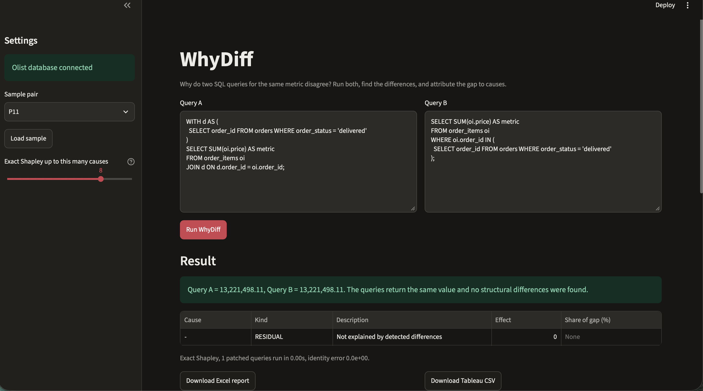
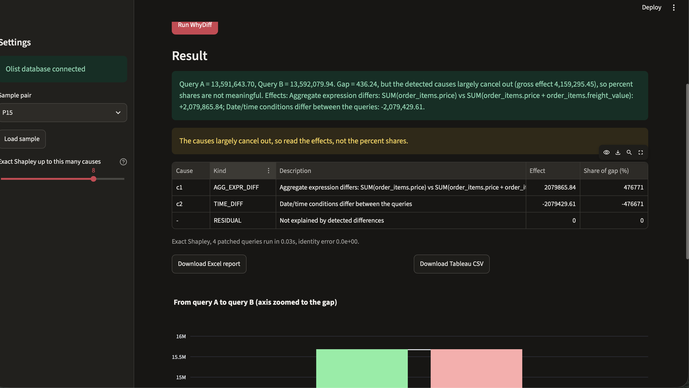
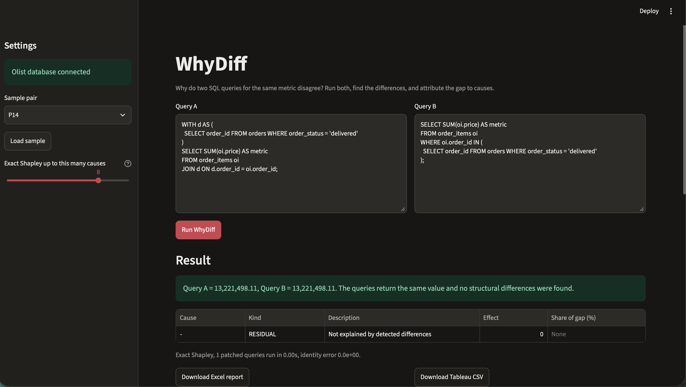
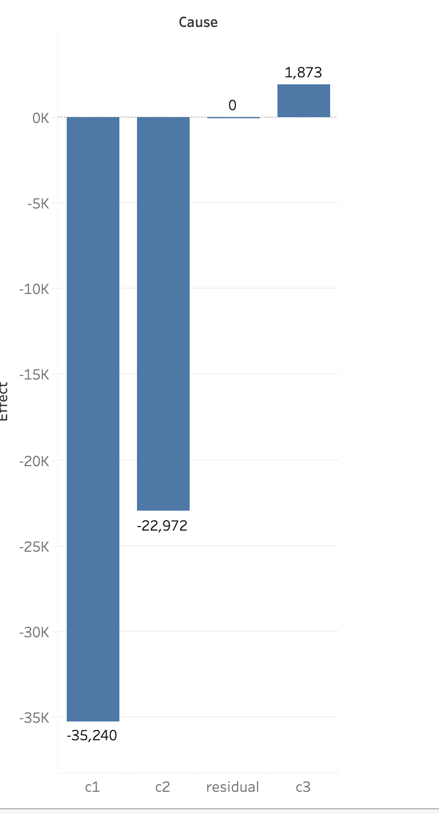
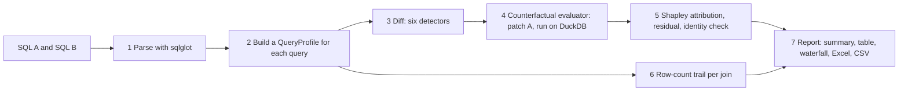

# WhyDiff

**Two SQL queries that should calculate the same metric return different numbers. WhyDiff finds the structural differences between them and attributes the numeric gap to named causes.**

Marketing reports revenue of 16.0M, Finance reports 13.6M, and nobody knows why. Usually the cause is a small SQL difference: a join that multiplies rows, a status filter, a different aggregate expression, a timezone shift. WhyDiff runs both queries on the same dataset, compares their structure, and puts a number on each cause, so a diagnosis that takes days by hand takes seconds.

It is free, local, deterministic Python and SQL. No LLM calls, no cloud, no paid APIs.

## Demo (pair P11)

Query A joins `order_payments` and filters November 2017 on the raw timestamp. Query B skips the payments join, keeps only delivered orders, and shifts the timestamp by 3 hours.

> Query A = 1,046,127.84, Query B = 989,788.55. Gap = -56,339.29: 63% join, 41% filter, -3% time (no unexplained residual).



The row-count trail shows why the join matters: in query A, `orders` (99,441 rows) joined to `order_items` gives 112,650 rows, and joining `order_payments` raises that to 117,601 rows, so `SUM(price)` counts some orders more than once.

When two causes nearly cancel (pair P15, gap 436.24 against effects of +2,079,865.84 and -2,079,429.61), the app warns that percent shares are not meaningful and shows effects instead:



When the two queries are logically the same (pair P14, a CTE versus an `IN` subquery), it reports no differences:



The Tableau-ready CSV opens directly in Tableau Public. The effects add up to the P11 gap (-56,339):



## How it works



1. **Parse.** Each query becomes a syntax tree (sqlglot, DuckDB dialect).
2. **Profile.** Joins, filters, date conditions, the aggregate and GROUP BY are extracted. Aliases are replaced by table names so equal logic compares equal.
3. **Diff.** Six detectors list differences: `FILTER_DIFF`, `JOIN_DIFF`, `JOIN_TYPE_DIFF`, `AGG_EXPR_DIFF`, `DISTINCT_DIFF`, `TIME_DIFF`.
4. **Evaluate.** For any subset of differences, query A is rewritten so those differences match B, then run. Results are cached.
5. **Attribute.** Exact Shapley values (up to 8 causes, 2^n query runs) split the gap fairly regardless of order. Above 8 causes a sampled estimate is used and labelled "estimated". The code checks that effects plus residual equal the gap and refuses to return a result otherwise.
6. **Diagnose.** The row count after each join is recorded and joins that multiply rows are flagged. This evidence is independent of the diff.
7. **Report.** One report object feeds the screen, the Excel workbook and the CSV, so they cannot disagree.

Anything the tool cannot parse or compare safely is reported as "unsupported". It never guesses. Anything the detectors cannot see lands in the residual, which is reported openly.

## Benchmark results

Sixteen query pairs were built from templates on the Olist dataset, so the planted causes are known by construction. Planted causes are read from each pair's `manifest.yaml`, not from the tool's output. Full results: [`results/benchmark.md`](results/benchmark.md).

Generated 2026-11-08 18:56.

| Metric | Value |
|---|---|
| Pairs run / completed | 16 / 16 |
| Mean cause recall (pairs with planted causes) | 100% over 15 pairs |
| Mean cause precision (pairs with reported causes) | 100% over 15 pairs |
| False positives on clean pairs | 0 over 1 pair(s) |
| Identity check passed | 16 / 16 |
| Largest identity error | 4.37e-11 |
| Single-cause pairs: max relative error | 0.000000% over 10 pairs |
| Multi-cause pairs: max order spread of one-at-a-time attribution | 8.3% over 5 pairs |
| Pairs where causes largely cancel (gross effect > 10x gap) | P15 |
| Total evaluations (distinct patched queries run) | 57 |
| Runtime per pair (mean / max, seconds) | 0.046 / 0.115 |

| Pair | A | B | Gap | Planted | Reported | Recall | Precision | Residual |
|---|---|---|---|---|---|---|---|---|
| P01 | 13,591,643.70 | 13,221,498.11 | -370,145.59 | 1 | 1 | 100% | 100% | 0.00 |
| P02 | 14,209,115.34 | 13,591,643.70 | -617,471.64 | 1 | 1 | 100% | 100% | 0.00 |
| P03 | 13,591,643.70 | 15,843,553.24 | 2,251,909.54 | 1 | 1 | 100% | 100% | 0.00 |
| P04 | 16,008,872.12 | 15,843,553.24 | -165,318.88 | 3 | 1 | 100% | 100% | 0.00 |
| P05 | 13,527,224.77 | 13,591,643.70 | 64,418.93 | 1 | 1 | 100% | 100% | 0.00 |
| P06 | 14,209,115.34 | 14,209,250.31 | 134.97 | 1 | 1 | 100% | 100% | 0.00 |
| P07 | 1,010,271.37 | 1,012,294.55 | 2,023.18 | 1 | 1 | 100% | 100% | 0.00 |
| P08 | 99,441.00 | 96,096.00 | -3,345.00 | 1 | 1 | 100% | 100% | 0.00 |
| P09 | 14,209,115.34 | 13,221,498.11 | -987,617.23 | 2 | 2 | 100% | 100% | 0.00 |
| P10 | 13,591,643.70 | 15,419,773.75 | 1,828,130.05 | 2 | 2 | 100% | 100% | 0.00 |
| P11 | 1,046,127.84 | 989,788.55 | -56,339.29 | 3 | 3 | 100% | 100% | 0.00 |
| P12 | 112,650.00 | 98,666.00 | -13,984.00 | 1 | 1 | 100% | 100% | 0.00 |
| P13 | 120.65 | 137.75 | 17.10 | 1 | 1 | 100% | 100% | 0.00 |
| P14 | 13,221,498.11 | 13,221,498.11 | 0.00 | 0 | 0 | n/a | n/a | 0.00 |
| P15 | 13,591,643.70 | 13,592,079.94 | 436.24 | 2 | 2 | 100% | 100% | 0.00 |
| P16 | 1,046,127.84 | 1,155,443.93 | 109,316.09 | 4 | 4 | 100% | 100% | 0.00 |

Multi-cause pairs, with the share of the gap for each cause (exact Shapley):

| Pair | Cause | Kind | Effect | Share of gap |
|---|---|---|---|---|
| P09 | c1 | JOIN_DIFF | -604,901.12 | 61.2% |
| P09 | c2 | FILTER_DIFF | -382,716.11 | 38.8% |
| P10 | c1 | FILTER_DIFF | -396,962.54 | -21.7% |
| P10 | c2 | AGG_EXPR_DIFF | 2,225,092.59 | 121.7% |
| P11 | c1 | JOIN_DIFF | -35,240.08 | 62.5% |
| P11 | c2 | FILTER_DIFF | -22,972.49 | 40.8% |
| P11 | c3 | TIME_DIFF | 1,873.28 | -3.3% |
| P15 | c1 | AGG_EXPR_DIFF | 2,079,865.84 | 476771.0% |
| P15 | c2 | TIME_DIFF | -2,079,429.61 | -476671.0% |
| P16 | c1 | JOIN_DIFF | -38,509.17 | -35.2% |
| P16 | c2 | FILTER_DIFF | -24,650.70 | -22.5% |
| P16 | c3 | AGG_EXPR_DIFF | 170,607.08 | 156.1% |
| P16 | c4 | TIME_DIFF | 1,868.88 | 1.7% |

P15's shares are shown as produced, but they are not meaningful: the two causes cancel, so the tool tells you to read the effects instead.

**How to read this honestly.**
- The 16 pairs were built from the same templates the detectors were designed around. 100% recall shows in-scope behaviour. It does not show that the tool generalises.
- For multi-cause pairs the "true" split is defined by the same Shapley method, so correctness there rests on detection, the identity check, and the comparison against one-at-a-time attribution (largest order spread 8.3%, on P15). It is not an independent ground truth.
- P04 has three planted differences but one reported cause, because they depend on each other and are bundled into one combined cause. That is less detail, by design.

### Held-out pairs

To test generalisation, six pairs were written by hand in styles the detectors were not designed around, and the results are reported as they came out. Full results: [`results/heldout.md`](results/heldout.md). Predictions: [`docs/HELDOUT_PREDICTIONS.md`](docs/HELDOUT_PREDICTIONS.md). Run 2026-11-09 16:17.

| Outcome | Pairs |
|---|---|
| correct | 3 |
| declined (unsupported) | 2 |
| wrong | 1 |

| Pair | Style | Outcome | Reported (effect) |
|---|---|---|---|
| H01 | no aliases vs aliases, lower vs upper case | correct | FILTER_DIFF (-370,145.59) |
| H02 | unqualified vs qualified columns | wrong: extra cause | FILTER_DIFF (-370,145.59); AGG_EXPR_DIFF (+0.00) |
| H03 | join + WHERE vs `IN` subquery (same logic) | declined | semi-join conditions are not patchable in v1 |
| H04 | CTE that pre-aggregates payments | declined | JOIN to a CTE/subquery that is not a simple key list |
| H05 | different aliases and join order, comment, `NOT IN` | correct | JOIN_DIFF (+63,467.44); FILTER_DIFF (-96,291.47) |
| H06 | `BETWEEN` with date-only bound vs half-open range | correct | TIME_DIFF (+31,322.74) |

The predictions were written before the run, but they were not committed before it, because of a command error. Git history cannot prove the order, and the author had read the detector code first.

## Quick start

Tested on macOS with Python 3.14. The brief asks for Python 3.11 or newer.

```bash
git clone https://github.com/theammarngp-makes/whydiff.git
cd whydiff
python3 -m venv .venv
source .venv/bin/activate
pip install -r requirements.txt
```

The Olist data is **not** included in this repository. Download the Brazilian E-Commerce Public Dataset by Olist from Kaggle, put the nine CSV files in `data/raw/`, then:

```bash
python scripts/load_data.py          # builds data/olist.duckdb
python -m pytest -q                  # unit tests
python scripts/run_benchmark.py      # writes results/benchmark.md and .csv
python scripts/make_heldout.py       # writes benchmark/heldout/H01..H06
python scripts/run_heldout.py        # writes results/heldout.md and .csv
streamlit run app.py                 # opens http://localhost:8501
```

In the app, choose a sample pair in the sidebar (P11 is the default), press **Run WhyDiff**, then download the Excel report or the Tableau CSV. You can also paste your own two queries. They must use the Olist table names (`orders`, `order_items`, `order_payments`, and so on, without the `olist_` prefix or `_dataset` suffix).

## Related work

I could not find an existing open-source tool that does this (searched November 2026). The search was not exhaustive. What I did find:

- Student and governance projects that flag conflicting KPI definitions as text, without running queries.
- Semantic layers (dbt, Cube, Databricks metric views) that prevent drift by defining a metric once.
- Data observability tests (for example Elementary `metric_stability`) that alert when a settled historical number changes.
- Many tutorials that explain join fan-out and teach manual diagnosis.

Shapley-value attribution is an established technique and is not invented here. The contribution is applying it to the differences between two executed SQL queries.

## Limitations

The full list is in [LIMITATIONS.md](LIMITATIONS.md). The main points:

- Version 1 supports single SELECT statements with one aggregate and no GROUP BY. Window functions, recursive CTEs and correlated subqueries are unsupported.
- Attribution is exact only for differences the detectors can see. Everything else lands in the residual.
- Offsetting differences can cancel and hide a disagreement (P15).
- Attribution is relative to query A and depends on the data. It is a measurement, not causal proof.
- Only the DuckDB dialect is tested, on one dataset, with planted bugs. Real company queries may differ.

## What did not work

Real problems found during the build. The details are in [docs/WHAT_DID_NOT_WORK.md](docs/WHAT_DID_NOT_WORK.md).

- **The first offsetting pair did not offset (P15).** Cutting early orders also removes their freight, so a price-only cutoff did not cancel the freight added. I recalculated the cutoff using price plus freight.
- **The scorer undercounted a combined cause (P04).** Recall fell to 33% after switching to manifests, although the detectors had not changed. A reported cause could only match one planted cause. Fixed so a combined cause matches each member once.
- **The first exports looked wrong.** Floating-point noise, negative zeros and a "custom" label caused by whitespace were fixed.
- **Held-out pairs exposed two real gaps.** H02: unqualified and qualified column names in a multi-table query produced an extra cause with effect +0.00. H03: join plus filter versus `IN` subquery was refused although both return the same value.
- **A process slip.** The held-out predictions were not committed before the run.

## Project layout

```
app.py                      Streamlit app
src/whydiff/                loader, runner, profile, detectors, patchers, evaluator,
                            attribution, diagnostics, report, exporters, benchmark
benchmark/pairs/P01..P16    benchmark pairs (query_a.sql, query_b.sql, manifest.yaml)
benchmark/heldout/H01..H06  hand-written held-out pairs
scripts/                    make_pairs, run_benchmark, make_heldout, run_heldout, ...
tests/                      pytest suite (86 tests passed at last run)
results/                    benchmark and held-out outputs
docs/                       screenshots, what did not work, handbook module draft
```

## Credits

- [Olist Brazilian E-Commerce Public Dataset](https://www.kaggle.com/datasets/olistbr/brazilian-ecommerce) on Kaggle. The data is not redistributed here; check its licence on Kaggle before using it.
- [DuckDB](https://duckdb.org/), [sqlglot](https://github.com/tobymao/sqlglot), [Streamlit](https://streamlit.io/), [Plotly](https://plotly.com/python/), [openpyxl](https://openpyxl.readthedocs.io/).

Built by Mohammad Ammar. Licensed under MIT; see [LICENSE](LICENSE).